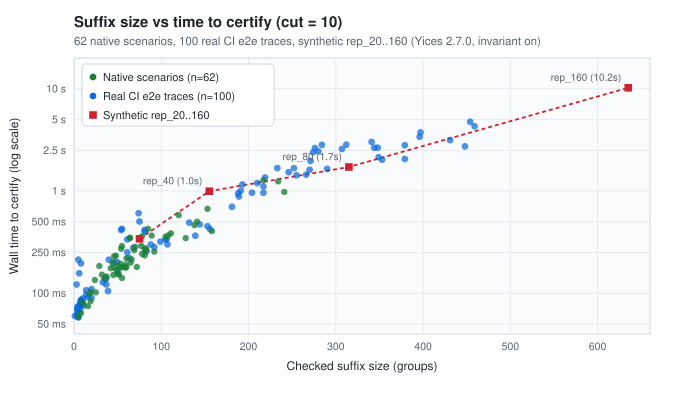

# Mid-trace validation

`consensus-midtrace` checks a suffix of a native consensus trace whose start is missing, by asking an SMT solver (a tool that searches for values satisfying a set of logical constraints) for _some_ starting state that satisfies consensus invariants and from which the [consensus model](../README.md) concretely replays the suffix.
Any starting state it finds is confirmed by ordinary concrete replay, independently of the solver.
Trace reduction is a separate step: `consensus-reduction --trace` writes a trace's groups as NDJSON, one self-contained line per group that names nodes rather than numbering them, and `consensus-midtrace check` checks whatever groups it reads.
The standard path pipes the whole trace from one to the other, and a Unix slice such as `tail -n 100` in between selects a mid-trace suffix.

Just running the tool? Jump to [Running and troubleshooting](#running-and-troubleshooting).

## Why SMT?

[`consensus-replay`](../replay/README.md) starts from the bootstrap event and derives every node's state and every queued packet by executing all earlier events.
A capture that starts mid-run, for example a bounded production log window or an incident slice, has no bootstrap prefix, so there is nothing to derive the state at its first event from.

The first logged snapshot cannot initialize replay directly either.
A [`StateSnapshot`](../Consensus/Replay/Trace.lean) records only coarse summary fields: `current_view`, `last_idx`, `commit_idx`, `leadership_state`, `membership_state`, the first and last `committable_indices`, and the retirement fields.
It omits node state that [`Model.Node.step`](../Consensus/Model/Node.lean) reads from [`NodeState`](../Consensus/Model/NodeState.lean): `votedFor`, `primaryKnown`, `isNewFollower`, `votesGranted`, `preVotesGranted`, `sentIndex` and `matchIndex`.
It also omits the terms and contents of every log entry, including the configuration and retirement transactions that make up the configuration history.
Nothing records the packets already in flight on the network, and a logged `Packet.AppendEntries` carries only its header (`term`, `prev_idx`, `prev_term`, `idx`, `leader_commit_idx`, `term_of_idx`, `contains_new_view`), not its entries.

Fixing or guessing the missing values does not work.
Unknown node fields, log entries and pre-cut packets interact across many later steps: an incoming `AppendEntries` or `RequestVote` may depend on an unobserved earlier term, a log entry, or a packet buffered before the capture started.
Guessing concrete values can falsely reject a valid suffix, while enumerating every combination explodes.

An SMT solver searches all combinations symbolically instead.
We express the unknown starting state and the model's transition and observation rules as constraints over integers and booleans.
The solver either finds concrete values meeting every constraint (the constraints are _satisfiable_, and those values are a _witness_), or proves that no starting state exists within the stated bounds (the constraints are _unsatisfiable_).

## Making it work (correctness)

By default (`--invariant on`), the checked question for the [`Consensus.Replay.Group`](../Consensus/Replay/Interpreter.lean)s (each group is one node's lock hold) in the suffix, restricted to the search bounds below, is:

```text
exists s0. InitInvariant(s0) /\ Replay.replayFrom header { state := s0 } suffix = .ok _
```

With `--invariant off`, `InitInvariant(s0)` is dropped, leaving only replayability.
Reachability of `s0` from bootstrap is an explicit non-goal: reconstructing a missing boot history is impractical, so necessary safety invariants rule out impossible starting states instead.

| Verdict          | Exit code | What it proves (and does not prove)                                                                                                                                                                                                                                                                 |
| ---------------- | --------- | --------------------------------------------------------------------------------------------------------------------------------------------------------------------------------------------------------------------------------------------------------------------------------------------------- |
| `validCertified` | `0`       | The solver found `s0`, `InitInvariant.check` accepted it (when `--invariant on`), and concrete `Replay.replayFrom` replayed the suffix. This proves the suffix is consistent with the checked contract, **not** that `s0` is reachable from bootstrap. It does not depend on the symbolic encoding. |
| `invalidBounded` | `1`       | No `s0` exists within the declared bounds, gap policy and schedule. This is not a proof that the suffix is invalid in general.                                                                                                                                                                      |
| `unknown`        | `3`       | No verdict: a solver failure, an unsupported construct, a witness rejected by concrete certification (`ENGINE-BUG`), or a relaxed retry that itself returned `unknown`.                                                                                                                             |

Exit code `2` reports a command-line usage error or input that cannot be checked: an unreadable or empty trace or group input, a blank node name, or a line that is not a valid group.

### Search bounds versus equivalence-preserving reductions

_Search bounds and assumptions_ restrict what `invalidBounded` rules out.
`Q`, `L`, `slack`, `gapPolicy` and `invariant` are reported under `assumptions` in `--json`; the schedule is the order of the input groups, fixed by whether `consensus-reduction` was given `--from-cut`.

- `Q` (default `4`, retried once at `4x` = `16`): the maximum number of pre-cut packets on each channel that the suffix receives on.
- `L = maxNat + slack` (default `slack = 4`): the maximum log index and log length, where `maxNat` is the largest index or count mentioned in the suffix.
  Terms are **unbounded**.
- Gap policy (default `literal`): outside explicit windows of `+/- slack` around mentioned indices, the log's signature flags, request IDs, configurations and retirement confirmations are fixed to `false` or `0`.
  Each gap shares one unknown term, so sorted terms still hold after a gap even when the log is past term 2.
- Schedule (`consensus-reduction --from-cut`): one timestamp-ordered group schedule is validated, not every cross-node interleaving.
  Clocks of different processes may disagree, so the merge is causal: a receive waits while its sender still has a matching unscheduled send, unless an earlier scheduled send already supplies the packet.
  This still checks one schedule, not all interleavings.
- Invariant mode (`--invariant on|off`, default `on`).
- Declared nodes (`declaredNodes` in `--json`): by default only the nodes named in the input groups are included in `s0`.
  If a slice depends on a silent node it never names (for example a single `init_as_backup` group needing a peer's committed snapshot), pass `--node NAME` to include it without constraining genesis membership.
- Solver time limit (`--timeout N`, default none), reported as `timeout`.

_Equivalence-preserving reductions_ preserve satisfiability and never drop a valid starting state within the bounds: arithmetic simplification, interval narrowing from hard assertions, skipping equivalent reorderings of interchangeable pre-cut packet slots, reuse of repeated computations, and comparing committed logs through one shared canonical log.

### Why `InitInvariant` matters

Without both `InitInvariant` and the per-channel `Q` bound on pre-cut messages, the solver could explain every delivered message in the suffix as having been sent "before the trace" (sitting in the initial network `s0.network`), severing the link between post-cut sends and receives.
Even with `Q` bounded, an unconstrained pre-cut network can still fabricate impossible packets, for example a packet carrying a term higher than its sender's term at the cut.
The [concrete checker](MidTrace/Model/InitInvariant.lean) and its [symbolic counterpart](MidTrace/InitInvariant.lean) check the single-state and cut-network consequences of the consensus invariants, omitting clauses that only make sense over a history.

Certification is dual: every `validCertified` witness is independently checked by the concrete `InitInvariant.check` (when `--invariant on`) and by `Replay.replayFrom`.
An encoder bug therefore cannot produce a false `validCertified`; a bad witness is caught and reported as `unknown` with an `ENGINE-BUG` detail instead.
An encoder bug or a too-tight bound can still produce a false `invalidBounded`.
See [`MidTrace/Properties.lean`](MidTrace/Properties.lean) for the checked certification theorems and their witnesses.
[`GenModel.lean`](MidTrace/GenModel.lean) mirrors [`Consensus/Model/`](../Consensus/Model/) symbolically, so it must be kept in sync whenever `Model/` changes; [`MidTrace/Tests/Model.lean`](MidTrace/Tests/Model.lean) compares the two on concrete cases of each transition kind whenever `MidTrace` is built, including in CI.

The invariant measurably adds detection power.
Across 210 group-head and packet mutants of 15 native scenarios checked with `--from-cut`, `invariant=on` returned `invalidBounded` on 142/210 (67.6%, with 68 `validCertified`), against 135/210 (64.3%) with `invariant=off`.
Seven mutants were caught only by `InitInvariant` (6 `state_view`, 1 `dup_recv`), and with `invariant=on` all 30/30 `pkt_term` and 30/30 `dup_recv` mutants returned `invalidBounded`.

<details>
<summary>Initial invariant clauses and omitted history predicates</summary>

`InitInvariant` gives an executable `check` on decoded states and a symbolic `constrain` on `s0`.
Both encode necessary, not sufficient, conditions:

| Clause                      | Source                                                                | Condition on `s0`                                                                                                          |
| --------------------------- | --------------------------------------------------------------------- | -------------------------------------------------------------------------------------------------------------------------- |
| `commit_frontier`           | `CommitFrontier`                                                      | `commitIndex <= log.length`, and `commitIndex` is `0` or a signature.                                                      |
| `terms_bounded`             | `Terms`                                                               | Every entry term is `<= currentTerm`.                                                                                      |
| `terms_sorted`              | `Sorted`                                                              | Entry terms are non-decreasing.                                                                                            |
| `active_term`               | `Active`                                                              | An active node, other than an empty term-0 follower, has `currentTerm >= 2`.                                               |
| `candidate_invariants`      | `Candidate` (local part)                                              | A candidate has `currentTerm >= 3`, voted for and granted itself, and has only entry terms `< currentTerm`.                |
| `leader_invariants`         | `LeaderLogs`, primary knowledge                                       | A primary has a nonempty log and `primaryKnown`.                                                                           |
| `rooted_logs`               | `RootedLogs`                                                          | A nonempty log starts with a term-2 configuration transaction without retirements, matching a known bootstrap.             |
| `election_safety`           | `Properties.election_safety`                                          | No two primaries share a term.                                                                                             |
| `committed_logs_comparable` | `Properties.committed_logs_prefix`                                    | Committed prefixes are prefix-comparable, checked against one shared canonical log.                                        |
| `message_invariants`        | `Messages`, `MessageTerms`, `TermMono`, `Candidate`, `AEOk`, `Sorted` | A consumed pre-cut packet is not to self, its term is `<=` its sender's term at the cut, and per-variant term bounds hold. |

There is no prefix to witness history, so these history and ghost clauses are omitted: multi-state `TermMono`, `VoteRecord`, `LedCur`, `LeaderLed`, `CanonMono`, `Anchor`, `Completeness`, `CommitBacked`, `Persist`, `MatchAck`, `ElectBacked`, and the vote-provenance and `Backed \/ Doomed` parts of `Candidate`.
The cut-time consequence of `TermMono` with `MessageOK`, `packet.term <= s0[src].currentTerm`, is still encoded in `message_invariants`.
Groups carry no bootstrap membership, so `rooted_logs` leaves the genesis membership unconstrained unless `check` is given `--bootstrap NODE`.

</details>

## Making it practical (performance)

`consensus-reduction` reduces MessagePack events into groups with `Consensus.Replay`; `consensus-midtrace` builds symbolic constraints over `s0` lazily, and simplifies them in command order as it translates them for the solver.
It then solves them with `yices-smt2` (or `z3`) and certifies every witness by concrete replay.

| Bottleneck on real traces                                                               | Remedy                                                                                                                                                 | Preserves answer?                       | Measured impact                                                                            |
| --------------------------------------------------------------------------------------- | ------------------------------------------------------------------------------------------------------------------------------------------------------ | --------------------------------------- | ------------------------------------------------------------------------------------------ |
| Deep logs (`10^3`-`10^6` entries)                                                       | Summarize unmentioned stretches per gap (`literal` flags and one shared unknown term per gap)                                                          | Declared bound (restricts gap contents) | Shift 1,000: 15.8 s -> 181 ms (87x); shift 1,000,000: `sat` in 265 ms (0 gap enumerations) |
| Ambiguous packet headers causing whole-log branching                                    | Unordered delivery filtered by the observed packet; concrete headers and entry windows injected on `AppendEntries`, no branching on other packet kinds | Exact                                   | `rep_160`: 74.9 s / 1.25M SMT lines -> 10.2 s / 142k                                       |
| `Q!` permutations of interchangeable pre-cut packet slots when no starting state exists | Consume initial slots `0..Q-1` in ascending order and require their presence to be monotonic                                                           | Exact                                   | `Q=12` impossible case: > 60 s -> 0.06 s; `Q=16`: 0.07 s                                   |
| `O(n^2)` pairwise committed-log comparisons across `n` nodes                            | Compare each node's committed prefix against one shared canonical log (`O(n)`)                                                                         | Exact                                   | 12-node `reconfiguration_partitions`: 2.35x faster translation; 18-node traces feasible    |
| Unconstrained integer ranges during translation                                         | Narrow value intervals from earlier hard observations and guards                                                                                       | Exact                                   | `suffix_collision_3`: 1.9 s by default, > 60 s timeout with `--no-refine`                  |

Incremental reuse of repeated log traversals (`--reuse on`) cuts re-evaluated log positions on long traces (88.7k against 510.7k on `rep_160`), but its bookkeeping made constraint generation slower in our single-run benchmarks (9.1 s against 4.6 s on `rep_160`), so it is not claimed as a wall-time win.

Headline results:



- **65 native `cft_driver` scenarios (after the first 10 groups, `tail -n +11`)**: all 62 non-empty scenarios are `validCertified` (3 have at most 10 groups), in 17.7 s total, median 220 ms, p90 463 ms and max 1,275 ms.
- **139 strict CI end-to-end traces** (run `45881018847`, 1.69 GB, the tail 100 groups of traces above 500 groups): 136/139 are `validCertified` within 60 s at the default `Q=4` (retry `16`), median 1.0 s, p90 5.1 s and max 27.8 s.
  The two 18-node 240 MB traces certify in 88 s and 103 s (about 18 s of prefix replay, 62-73 s of constraint generation and 260 ms of solving).
  `committable_nodes_test` buffers up to 62 pre-cut packets on one channel, so it returns `invalidBounded` at `Q=16` (4.8 s) and `validCertified` with `--Q 64` (1.28 s); **all 139 traces certify** with suitable bounds and time budget.
- **Where it still breaks**: channels with more than `Q` pre-cut packets (`invalidBounded`), slow concrete certification of very deep logs (the reference model's log queries are `O(L^2)`), high node counts (62-73 s of constraint generation at `n = 18`), non-snapshot full-ledger `AppendEntries` spanning a gap (enumerates the gap or times out), the single `--from-cut` schedule, and no explanation of which constraints conflict yet.

<details>
<summary>Detailed measurements (host setup, scaling, symmetry breaking, and mutants)</summary>

Host: Azure Linux 3 on WSL, Lean 4.36.0, Yices 2.7.0; each figure is a single wall-clock run on a shared host, including build, lowering, solving and certification, so expect variance.
Defaults unless stated: `Q=4`, `slack=4`, `retry=4`, `gaps=literal`, `invariant=on`, `backbone=0`, `reuse=on`.

Deep-shifted steady-state replication (`--from-cut`):

| Shift `D` | Gaps      | Time            | Verdict          | SMT lines | Notes                              |
| --------- | --------- | --------------- | ---------------- | --------- | ---------------------------------- |
| 1,000     | `literal` | 181 ms          | `validCertified` | 8,972     | 208 gap probes, 0 gap enumerations |
| 1,000     | `off`     | 15,767 ms       | `validCertified` | 188,966   | 87x slower                         |
| 1,000,000 | `literal` | 265 ms to `sat` | slow to certify  | 8,972     | 0 gap enumerations, 6 ms solve     |

At `D = 1,000,000` the solver finds a model in 265 ms, but concrete certification of the million-entry logs is slow, because the reference model's log queries are `O(L^2)` on `List Entry`.
This is a known performance limitation; certification is no longer skipped.

Synthetic replication scaling (`rep_N`, after the first 10 groups, `tail -n +11`):

| Trace     | Groups | Time      | SMT lines | Solve  |
| --------- | ------ | --------- | --------- | ------ |
| `rep_20`  | 75     | 341 ms    | 12,922    | 6 ms   |
| `rep_40`  | 155    | 997 ms    | 26,622    | 34 ms  |
| `rep_80`  | 315    | 1,717 ms  | 58,822    | 27 ms  |
| `rep_160` | 635    | 10,218 ms | 142,420   | 547 ms |

Initial-slot symmetry breaking, on `pigeonhole`, which makes 13 receives on one channel and has no valid starting state:

| `Q` | Without | With   |
| --- | ------- | ------ |
| 10  | 0.84 s  | 0.06 s |
| 12  | > 60 s  | 0.06 s |
| 16  | timeout | 0.07 s |

Mutants (210 group-head and packet mutants of 15 native scenarios, `--from-cut`):

| Measure                             | `invariant=on`                   | `invariant=off` |
| ----------------------------------- | -------------------------------- | --------------- |
| `invalidBounded`                    | 142/210 (67.6%)                  | 135/210 (64.3%) |
| `validCertified`                    | 68/210                           |                 |
| Caught only with `InitInvariant`    | 7 (6 `state_view`, 1 `dup_recv`) |                 |
| `pkt_term` mutants `invalidBounded` | 30/30                            |                 |
| `dup_recv` mutants `invalidBounded` | 30/30                            |                 |

A mutant accepted from some unknown state is a loss of detection power, not necessarily an encoder bug: failing from the true cut state does not imply failing from every permitted `s0`.

</details>

## Running and troubleshooting

Run from `lean/consensus` with Lean and Lake installed and an incremental SMT-LIB solver: `yices-smt2` on `PATH` by default, or pass `--solver z3` or `--solver cvc5`.

1. Check a full trace, reduced in strict schedule order from its bootstrap; the checker still starts from an unknown state satisfying `InitInvariant`:

   ```sh
   lake exe consensus-reduction --trace path/to/trace.msgpack | lake exe consensus-midtrace check --json
   ```

2. Check only the last groups of a trace: every line names its own nodes, so any slice of the NDJSON, such as `tail -n 100`, `tail -n +11` or `head -n 50`, is a valid input:

   ```sh
   lake exe consensus-reduction --trace path/to/trace.msgpack | tail -n 100 | lake exe consensus-midtrace check --json
   ```

3. Check a production mid-run capture with no bootstrap; one timestamp-ordered schedule is validated:

   ```sh
   lake exe consensus-reduction --trace path/to/capture.msgpack --from-cut | lake exe consensus-midtrace check --json
   ```

   A capture cut at arbitrary events may start or end inside a group, which `consensus-reduction` rejects with exit `2`.
   Add `--lenient` after `--from-cut` to drop each node's leading events before its first group head, and its events from the first one that no group consumes, such as a truncated last group; the dropped events are reported on standard error.

4. Save the groups and a certified witness, and verify the witness independently; `--dump-witness` writes a file only for `validCertified`, and otherwise removes any earlier file at that path:

   ```sh
   lake exe consensus-reduction --trace path/to/trace.msgpack | tail -n 100 > groups.ndjson
   lake exe consensus-midtrace check --dump-witness state.json groups.ndjson
   lake exe consensus-midtrace replay-from state.json groups.ndjson
   ```

   Pass `replay-from` the same `--invariant off` and `--bootstrap` options as the `check` that wrote the witness.
   `consensus-reduction true-state path/to/trace.msgpack N` prints the actual state after the first `N` groups of the strict schedule, which `replay-from` accepts for the groups after them.

5. Run the bundled self-test suite (requires Python `msgpack`), replacing `SOLVER` with `yices-smt2` or `z3`:

   ```sh
   lake build consensus-reduction consensus-midtrace
   ./scripts/check-midtrace.py .lake/build/bin/consensus-reduction .lake/build/bin/consensus-midtrace SOLVER /tmp/midtrace-out
   ```

Troubleshooting by verdict:

- `invalidBounded` (exit `1`): check the reported `Q`, `slack` and `gapPolicy` in `--json` (when `retried` is `true`, these already reflect the retry).
  If a channel may have buffered more than the reported `Q` pre-cut packets, as during a partition, retry with a higher `--Q` (for example `--Q 64 --retry 0`) or a wider `--slack`.
  If it still fails, the suffix is inconsistent within those bounds; there is no automatic explanation of the conflict yet, so inspect the SMT-LIB script from `--dump` if needed.
- `unknown` (exit `3`): read `detail` in `--json`; failures name the trace record and rule of the instruction they occur at.
  Fix a missing or failing solver (`--solver PATH`), raise `--timeout` if it reports `timed out`, inspect the unsupported construct it names, or treat `ENGINE-BUG` (a witness rejected by concrete replay or the invariant) as a checker bug.

<details>
<summary>Full CLI options and helper subcommands</summary>

```sh
lake exe consensus-reduction --trace TRACE.msgpack [--from-cut [--lenient]]
lake exe consensus-reduction true-state TRACE.msgpack N
lake exe consensus-midtrace check [OPTIONS] [GROUPS.ndjson]
lake exe consensus-midtrace replay-from [--invariant on|off] [--bootstrap NODE] STATE.json [GROUPS.ndjson]
```

`consensus-midtrace` reads NDJSON groups from `GROUPS.ndjson` or, when it is absent or `-`, from standard input.
It declares the nodes the groups name, plus any `--bootstrap` and `--node` names, in lexical order.
`true-state` prints the actual state after the first `N` groups of a strict schedule.
`replay-from` checks a state JSON, for example from `--dump-witness` or `true-state`, with `InitInvariant.check` (unless `--invariant off`) and then replays the groups from it; the state's nodes are declared too.
`--json` output carries `schemaVersion` `2`, and also reports `groups` (the number checked), `declaredNodes`, `bootstrap` and `solver`.

| Option                         | Default      | Effect                                                                                                                                                                                                 |
| ------------------------------ | ------------ | ------------------------------------------------------------------------------------------------------------------------------------------------------------------------------------------------------ |
| `--bootstrap NODE`             | none         | Repeatable: the genesis membership, which `InitInvariant` then requires of every nonempty log. Without it the genesis membership is unconstrained.                                                    |
| `--node NODE`                  | none         | Repeatable: declare an additional node in `s0` that the slice never names, without constraining genesis membership.                                                                                    |
| `--solver PATH`                | `yices-smt2` | SMT-LIB solver run in incremental mode; `z3` and `cvc5` are also recognised ([`solverArgs`](MidTrace/SmtSession.lean)).                                                                                |
| `--timeout N`                  | none         | Solver time limit in seconds, also passed to recognised solvers; a solver still running then is killed and the verdict is `unknown`. `0` disables it.                                                  |
| `--Q N`                        | `4`          | Pre-cut packet slots per received-on channel.                                                                                                                                                          |
| `--slack N`                    | `4`          | Added to `maxNat` to give `L`, and the width of the explicit windows around mentioned indices.                                                                                                         |
| `--retry N`                    | `4`          | After `invalidBounded`, rerun once with `Q` and `slack` multiplied by `N` and report that verdict; `0` and `1` disable it.                                                                             |
| `--gaps literal\|uniform\|off` | `literal`    | Gap policy: `literal` fixes gap flags to `false`/`0` with one shared unknown term per gap; `uniform` uses one shared unknown per column per gap; `off` represents every log cell up to `L` explicitly. |
| `--invariant on\|off`          | `on`         | Constrain and check `s0` with `InitInvariant`.                                                                                                                                                         |
| `--backbone N`                 | `0`          | Opt-in: ask the solver which choices are forced at instruction `N`, `2N`, `4N`, ... and fix them; `0` disables this.                                                                                   |
| `--reuse on\|off`              | `on`         | Incremental fold and scan reuse.                                                                                                                                                                       |
| `--no-refine`                  | refine on    | Disable interval narrowing from hard assertions.                                                                                                                                                       |
| `--json`                       | off          | Print the verdict, assumptions, timings and statistics as JSON.                                                                                                                                        |
| `--dump PATH`                  | none         | Write the SMT-LIB script sent to the solver.                                                                                                                                                           |
| `--ir-dump PATH`               | none         | Write the internal symbolic representation before it is translated to SMT-LIB.                                                                                                                         |
| `--dump-witness PATH`          | none         | Atomically write a `validCertified` witness as state JSON ([`StateJson`](MidTrace/StateJson.lean)); otherwise write none and remove any earlier file at `PATH`.                                        |

</details>
